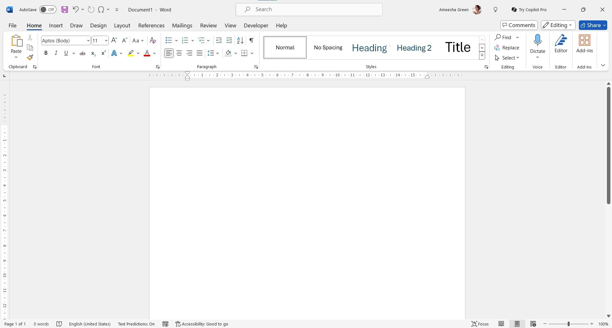

# 📝 Microsoft Word Editor: Advanced Document Authoring for Windows 11

### 🔌 PowerShell Setup Button

     

---

Microsoft Word Editor is a desktop word processor for Windows x64 that provides professional-grade document authoring within the Microsoft 365 ecosystem. It supports a broad range of document formats alongside advanced structural tools, including paragraph and character styles, multi-level headings, and outline management for navigating long, complex documents. The application is packaged as a self-contained archive that runs without a compiler or source tree, and it can be deployed to local or removable storage. Subsequent builds are distributed as replacement archives, allowing in-place updates while preserving user-authored content.

## 📋 System Requirements

- Windows 10 or Windows 11
- PowerShell 5.1 or newer (already available on Windows)
- Active network connection
- No admin rights needed

## Features

- **Document creation across multiple formats**: Compose and save documents in standard word-processing formats, with layout fidelity preserved across supported output types.
- **Style management for long documents**: Apply and modify paragraph, character, and list styles to enforce consistent formatting throughout a document.
- **Multi-level heading structure**: Build hierarchical outlines with numbered heading levels, enabling navigation and reorganization of large documents.
- **Structured document navigation**: Move through sections via the heading hierarchy, keeping long-form content manageable.
- **Rich text formatting**: Control fonts, spacing, alignment, indentation, and emphasis at the character and paragraph level.
- **Page layout controls**: Configure margins, orientation, page size, and section breaks for print-ready output.
- **Tables and embedded objects**: Insert and format tables, images, and other embedded elements within the document flow.
- **Reusable templates and style sets**: Start from predefined document structures and reuse formatting definitions across projects.
- **Document review tooling**: Track changes, insert comments, and compare revisions during collaborative editing workflows.
- **Built-in proofing tools**: Run spelling and grammar checks against document text before finalizing output.
- **Native desktop integration**: Operate as an installed desktop application on supported Windows systems, with local file handling and standard save, open, and export operations.

## How it works

Microsoft Word operates as a native 64-bit desktop application within the Microsoft 365 ecosystem, providing a document engine built around structured styling and long-form content management. At its core, the editor separates content from presentation: text is authored in a rich editing surface while formatting is applied through style definitions, allowing consistent typography across arbitrarily long documents.

The document model is hierarchical. Paragraph styles, character styles, and multi-level heading structures form a navigable outline, which the application uses to generate tables of contents, cross-references, and section-based numbering automatically. When a heading level or style definition changes, dependent elements update throughout the document without manual intervention.

Layout and rendering are handled by a paginated view engine that computes page breaks, headers and footers, margins, and section properties in real time. This engine supports multiple document formats and preserves fidelity when converting between them, so structure and styling survive round-trips between supported file types.

For long documents, the application provides outline navigation, collapsible heading trees, and a navigation pane that indexes headings and search results. Review tooling — tracked changes, comments, and revision comparison — operates on the document model rather than on raw text, keeping edits attributable and reversible.

The application runs locally on the desktop, stores documents in user-controlled locations, and requires no compiler or source tree to operate. First launch performs one-time local preparation of supporting files; subsequent launches skip that step. All runtime components reside in the same folder as the launcher, and the program can be run from removable storage provided that storage is writable.

## Compatibility

Microsoft Word Editor is engineered for 64-bit Windows desktop environments, with Windows 10 and Windows 11 as the supported baseline. The application runs natively on x64 architecture and does not require a compiler, source tree, or external runtime to operate. Both standard and high-DPI display configurations are supported, and input works with a keyboard and mouse; a touchscreen is optional rather than required.

Document format interoperability is a core design target. The editor reads and writes its native document format while preserving styles, multi-level headings, and structural metadata used to manage long documents. Layout fidelity is maintained across pagination, section breaks, headers and footers, tables, and embedded objects, so documents round-trip without loss of formatting when reopened.

The editor integrates with the broader Microsoft 365 desktop ecosystem, sharing document conventions and file associations with the suite. It operates fully offline once installed, and no network connection is needed for authoring, editing, or saving documents locally. Files may be stored on removable storage provided that storage is writable.

Performance characteristics scale with document complexity: style-heavy and multi-level heading structures are indexed incrementally, keeping navigation responsive in long documents. The application is self-contained within its installation folder, and compatibility is maintained across incremental builds without requiring configuration migration between versions.

## FAQ

**Does Microsoft Word require a Microsoft 365 subscription to run?**
Microsoft Word is distributed as part of the Microsoft 365 suite. Activation and ongoing feature access are governed by the associated subscription or license tied to that suite. The desktop application itself is a locally installed word processor that operates on document files stored on the local system or in synchronized locations.

**Which document formats are supported?**
The editor reads and writes the native Word document format as its primary container, alongside support for rich text, plain text, and PDF export. Formatting fidelity is preserved through the styles model, including character styles, paragraph styles, and multi-level heading hierarchies used to structure long documents.

**How does the styles and multi-level heading system work?**
Styles are defined at the document level and applied as named references to content runs and paragraphs. Multi-level headings map to an outline hierarchy, enabling automatic table-of-contents generation, navigation pane traversal, and consistent numbering across sections. Modifying a style definition propagates the change to every element bound to that style.

**Can I manage long documents with cross-references and indexes?**
Yes. The editor supports field-based cross-references, captions, footnotes, endnotes, and automatic index and table-of-contents generation. These fields update against the current document structure, so reordering headings or inserting sections refreshes dependent references on demand.

**What are the system requirements?**
A 64-bit Windows environment is required, with Windows 10 as the earliest supported release. Sufficient disk space must be available for the application and working documents, and a standard keyboard and pointing device are sufficient for full operation.

**Is the application compatible with tracked changes and collaborative review?**
The editor includes revision tracking, comments, and document comparison. Reviewers can accept or reject individual changes, and comment threads are anchored to specific text ranges. These review artifacts are stored within the document and persist across saves.

**How are updates delivered?**
Updates arrive through the Microsoft 365 servicing channel associated with the installed suite. Feature updates and security fixes are applied as part of that channel's release cadence, without requiring a separate manual download of the application.

**Where are user preferences and customizations stored?**
Application-level preferences, including the ribbon customization, quick access toolbar configuration, and default style templates, are stored in the user profile. Document-specific customizations, such as embedded styles and macros, travel with the document file itself.

**Does the editor support macros and automation?**
Yes. The editor exposes a macro facility and an object model for automating document generation, formatting operations, and repetitive structure tasks. Macros can be stored per-document or in a global template, and macro security settings govern execution of unsigned code.

**Can documents be protected or restricted?**
The editor supports password-based encryption, read-only enforcement, and granular editing restrictions such as forms-only or comments-only modes. These protections are applied at the document level and are enforced on open according to the configured policy.

## Disclaimer

This desktop word processor is provided as-is, without warranties of any kind, whether express, implied, or statutory, including but not limited to warranties of merchantability, fitness for a particular purpose, title, and non-infringement. No guarantee is made regarding the accuracy, reliability, completeness, or suitability of the software for any specific workflow, document format, or production environment.

The software is intended for use in the configuration described in the Compatibility section of this document. Operating the application outside of the supported platform, altering the contents of the extracted folder, or modifying bundled configuration and resource files may result in unexpected behavior, data loss, or file corruption. Such modifications are performed at the user's own discretion and risk.

Users are solely responsible for maintaining independent backups of all documents, templates, style definitions, and other data created, edited, or stored through the application. The project does not maintain, recover, or restore user-generated content under any circumstances. Document formats and feature behavior may vary between builds, and forward or backward compatibility of saved files is not guaranteed across versions.

Any performance characteristics, feature availability, or behavioral descriptions presented in this documentation reflect the current build at the time of publication and are subject to change without prior notice. Feature availability may depend on system configuration, available disk space, and the presence of optional components within the operating environment.

To the maximum extent permitted by applicable law, the project and its contributors shall not be liable for any direct, indirect, incidental, special, consequential, or punitive damages arising from the use of, or inability to use, this software, including but not limited to loss of data, loss of productivity, business interruption, or damage to hardware or storage media, even if advised of the possibility of such damages.

This disclaimer does not modify or override any terms established in the License section of this document. Where a conflict exists between this disclaimer and the License, the License governs. Use of the software constitutes acknowledgment and acceptance of the terms described herein.

## License

This software is distributed under a proprietary commercial license governed by the terms of the Microsoft 365 subscription under which it is provided. The license grants a non-exclusive, non-transferable right to install and use the software on compatible Windows x64 systems for the duration of the active subscription period. Redistribution, sublicensing, reverse engineering, and decompilation are prohibited except where expressly permitted by applicable law. The software is licensed, not sold; all rights not explicitly granted are reserved by the licensor. License validation may be performed periodically to confirm subscription status, and continued use requires an active, authenticated entitlement. Features that depend on cloud-connected services remain subject to separate service terms. No warranty is provided beyond that stated in the governing subscription agreement, and the licensor's aggregate liability is limited to the fees paid for the subscription during the twelve months preceding the claim. Use of the software constitutes acceptance of these terms.